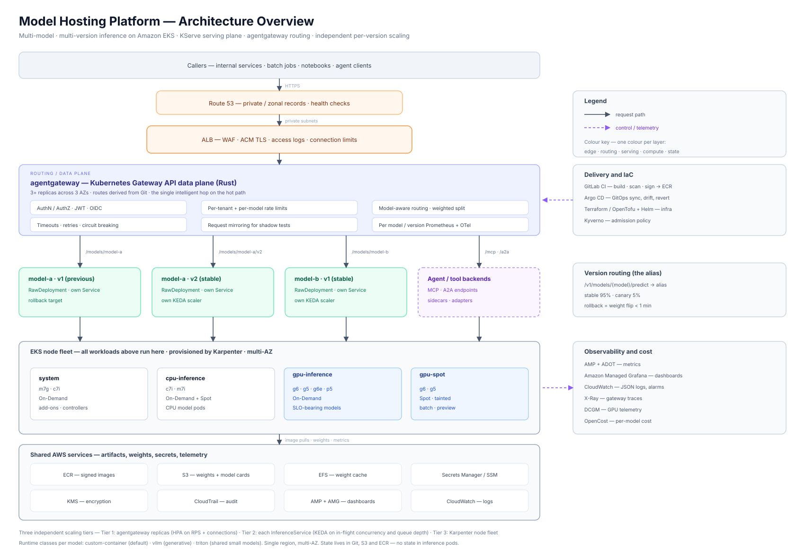
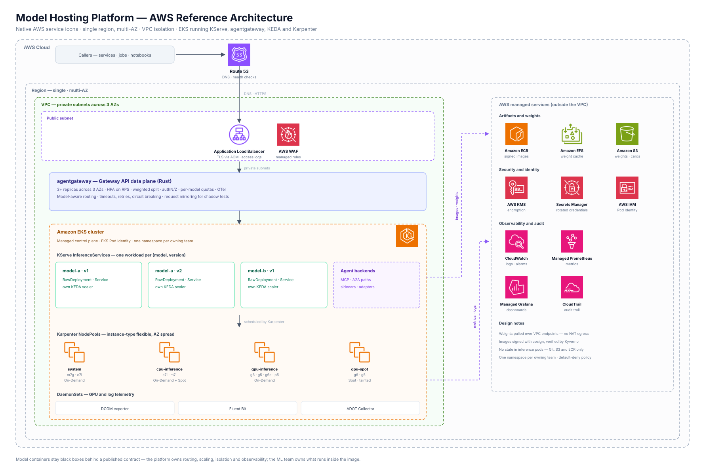
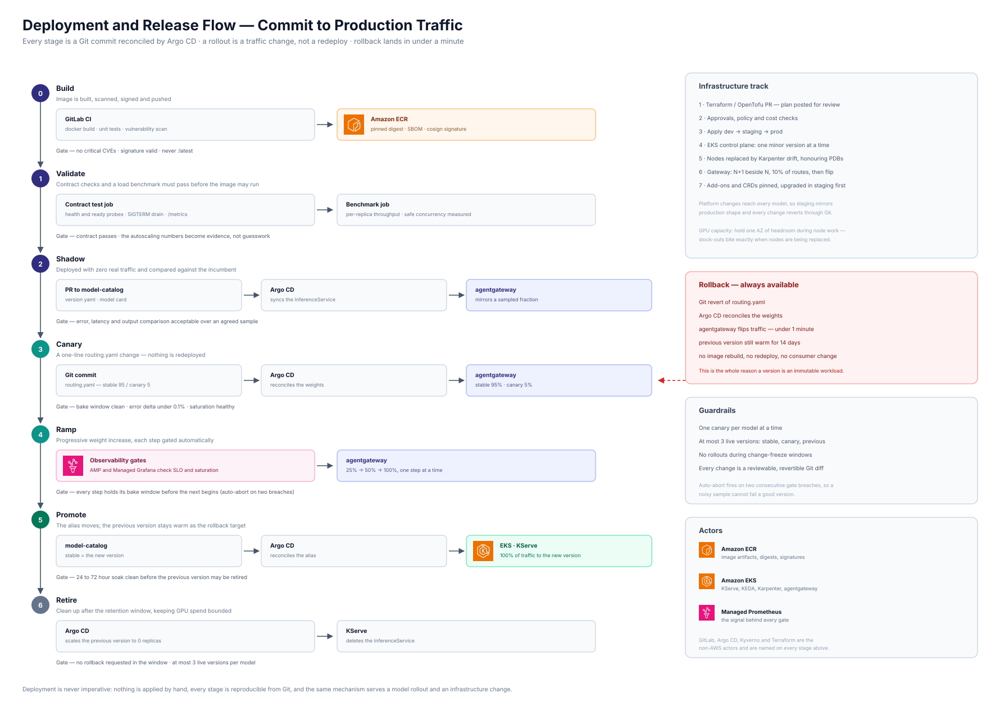

# Model Hosting Platform — Assessment

**A scalable, multi-model, multi-version inference platform on Amazon EKS**

---

## Table of Contents

1. [Executive Summary](#1-executive-summary)
2. [Problem Statement & Assumptions](#2-problem-statement--assumptions)
3. [Architecture](#3-architecture)
4. [Set-up](#4-set-up)
5. [Monitoring and Observability](#5-monitoring-and-observability)
6. [Operations](#6-operations)

---

## 1. Executive Summary

This document describes a platform that hosts **many different machine-learning models, in several versions each, simultaneously as described in the description of the assessment**, where every model arrives from the ML team as an opaque **Docker image exposing a predefined HTTP inference endpoint**. The platform's job is to run those containers, expose them behind stable, governed URLs, scale each model version **independently** on demand, and operate them with the resilience and observability you would expect from a production-grade API platform.

### Key processes or technologies used

(i) Gitlab {Repos and CI/CD Pipelines}

(ii) AWS EKS {Infrastructure}

(iii) IaC {Terraform/open-tofu with Helm}

(iv) Deployment {GitOps with ArgoCD}

(v) Gateway {Agentgateway (<https://agentgateway.dev/>) for model routing, failovers}

(vi) Serving control plane {KServe}

(vii) Monitoring {Grafana, Prometheus, FluentBit, Cloudwatch Agent}

---

## 2. Problem Statement & Assumptions

### 2.1 What the assessment brief actually specifies

> "Some models come from the machine learning team as Docker images, capable of serving inference one by one at predefined HTTP endpoints. Multiple different models, and multiple versions of the same model, can be hosted simultaneously, and each must be able to scale independently according to demand."

### 2.2 Assumptions

Below are some assumptions which I have considered for completing the entire work:

(i) Models are synchronous, stateless and request/responses are from HTTP services with no session affinity and durable states.
(ii) Traffic is internally originated {service to service within org}
(iii) No active/active set up and considering multi-AZ with single region

## 3. Architecture

### 3.1 Layered view



```text
                              ┌─────────────────────────────────────────┐
   Internal apps / services ──┤  Route 53  (private/zonal records)      │
   Batch jobs / notebooks  ───┤  + optional CloudFront for public edges │
                              └────────────────────┬────────────────────┘
                                                   │ TLS (ACM)
                              ┌────────────────────▼────────────────────┐
                              │  ALB (internal or public)               │
                              │  WAF, access logs, connection limits    │
                              └────────────────────┬────────────────────┘
                                                   │ HTTP, private subnets
   ┌───────────────────────────────────────────────▼──────────────────────────────────────────────┐
   │  AGENTGATEWAY  (Kubernetes Gateway API data plane, Rust)            [3+ replicas, 3 AZs]     │
   │  ─ authN/authZ (JWT/OIDC)      ─ per-tenant + per-model rate limits                         │
   │  ─ model-aware routing          ─ weighted splitting (canary/rollback)                      │
   │  ─ timeouts, retries, circuit breaking, request mirroring                                   │
   │  ─ OTel traces + Prometheus metrics (per model, per version, per tenant)                    │
   └───┬──────────────────────────┬──────────────────────────┬──────────────────────────┬─────────┘
       │ /models/a (alias)        │ /models/a/v2             │ /models/b                │ /mcp, /a2a
       │                          │                          │                          │ (agent paths)
   ┌───▼──────────────┐   ┌───────▼──────────┐      ┌────────▼─────────┐        ┌────────▼─────────┐
   │ KServe ISVC      │   │ KServe ISVC      │      │ KServe ISVC      │        │ sidecar services │
   │ model-a  v1      │   │ model-a  v2      │      │ model-b  v1      │        │ (tools, adapters)│
   │ ─ own Deployment │   │ ─ own Deployment │      │ ─ own Deployment │        └──────────────────┘
   │ ─ own KEDA scaler│   │ ─ own KEDA scaler│      │ ─ own KEDA scaler│
   │ ─ own Service    │   │ ─ own Service    │      │ ─ own Service    │
   └───┬──────────────┘   └───────┬──────────┘      └────────┬─────────┘
       └──────────────────────────┴──────────────────────────┘
                                  │  scheduled by Karpenter
   ┌──────────────────────────────▼──────────────────────────────────────────────────────────────┐
   │  EKS NODE FLEET (multi-AZ)                                                                  │
   │  ┌──────────────┐ ┌──────────────┐ ┌──────────────┐ ┌────────────────────────────────────┐ │
   │  │ system pool  │ │ cpu-inference│ │ gpu-inference│ │ gpu-inference-spot (batch/preview) │ │
   │  │ m7g/c7i      │ │ c7i / m7i    │ │ g6 / g5 / p5 │ │ spot, interrupt-tolerant           │ │
   │  └──────────────┘ └──────────────┘ └──────────────┘ └────────────────────────────────────┘ │
   └─────────────────────────────────────────────────────────────────────────────────────────────┘
                                  │
   ┌──────────────────────────────▼──────────────────────────────────────────────────────────────┐
   │  SHARED SERVICES                                                                            │
   │  ECR (images, signed, scanned)   S3 (weights + model cards)   EFS (shared weight cache)      │
   │  Secrets Manager / SSM           AMP + AMG + CloudWatch       KMS      CloudTrail            │
   └─────────────────────────────────────────────────────────────────────────────────────────────┘
```

### 3.2 Request path walkthrough

| # | Hop | Responsibility |
|---|---|---|
| 1 | Route 53 | Name resolution, health-checked routing |
| 2 | ALB | TLS termination, WAF, access log, connection limits |
| 3 | agentgateway | Auth, quota check, model+version resolution, weighted backend selection, trace start |
| 4 | Kubernetes Service | ClusterIP load balance to ready endpoints |
| 5 | Model pod | Actual inference (budget remainder) |
| 6 | agentgateway | Response metrics, token counting (if LLM schema) |

> ALB and agentgateway are not redundant. ALB is the AWS requirement for ensuring: WAF, ACM certificates, access logging, connection-level protections, and a stable DNS entry point — things agentgateway does not want to own. agentgateway is the *model-aware* control point: it understands models, versions, tenants and quotas.

### 3.3 Serving layer: how a model becomes a workload

Each `(model, version)` becomes exactly one KServe `InferenceService` in a namespace derived from its owning team:

```text
InferenceService  name: model-a-v2
  labels: model=model-a, version=v2, owner=team-x, tier=stable|canary
  runtime class:  custom-container   (or: vllm | huggingface | triton)
  deploymentMode: RawDeployment      (no Knative — no proxy hop, no cold-start penalty)
  replicas:       min 2 / max 30     (per-workload, independent)
  autoscaler:     KEDA on concurrency + queue depth
  resources:      requests/limits + GPU count
  weights:        s3://models/model-a/v2  →  Mountpoint CSI
```

**Runtime classes** — to get an agnostic approach with respect to models:

| Runtime class | Used when |
|---|---|
| `custom-container` | Default. Any image |
| `vllm` | Model is a generative LLM and the ML team wants batching/serving optimised |
| `triton` | Many small models of mixed frameworks that could share a process/node |

### 3.4 Gateway layer

| Path pattern | Resolves to |
|---|---|
| `/v1/models/{model}/predict` | Alias route → weighted split across versions |
| `/v1/models/{model}/versions/{version}/predict` | One specific `InferenceService` Service |
| `/v1/models/{model}/` (metadata) | Platform metadata service |
| `/mcp`, `/a2a` | Agent/tool backends |

The alias is the load-bearing abstraction. It means a model can move from v2 to v3 with **zero consumer change** and **zero-downtime rollback**, because rollback is a weight change, not a deployment.

### 3.5 Scaling design — three tiers

```text
Tier 3  ┌──────────────────────────────────────────────────────────┐
        │ Karpenter: node fleet   (instance-type flexible, Spot    │
        │ where tolerant, consolidation, AZ spread)                │
        └──────────────────────────────────────────────────────────┘
Tier 2  ┌──────────────────────────────────────────────────────────┐
        │ KEDA per (model,version): concurrency / queue depth      │
        │ independent min & max per workload                       │
        └──────────────────────────────────────────────────────────┘
Tier 1  ┌──────────────────────────────────────────────────────────┐
        │ agentgateway replicas: HPA on RPS + connection count     │
        └──────────────────────────────────────────────────────────┘
```

Each tier scales on a *different* signal because each tier saturates for a *different* reason. A model's traffic surge triggers Tier 2, which creates pending pods, which triggers Tier 3, which provisions GPU capacity. Tier 1 is independent of any single model.

#### 3.5.1 Tier 3 — node provisioning with Karpenter

| Node pool | Instance families | Capacity | Purpose |
|---|---|---|---|
| `system` | m7g / c7i | On-Demand | Core add-ons, Karpenter itself, gateway-adjacent components |
| `cpu-inference` | c7i, m7i (flexible) | On-Demand + Spot mix | CPU model pods |
| `gpu-inference` | g6 (L4), g5 (A10G), g6e (L40S), p5 (H100) — **flexible list** | On-Demand | SLO-bearing GPU models |
| `gpu-spot` | g6 / g5 | Spot | Batch, preview, experimentation; tainted so only tolerant workloads land |



---

## 4. Set-up

### 4.1 Repository layout

Two repositories, deliberately separated, because they have different owners, change frequency and review requirements:

```text
platform-infra/                  # owned by platform team;
├── modules/
│   ├── network/                 # VPC, subnets, private endpoints, NAT
│   ├── eks/                     # cluster, node pools, Karpenter, add-ons
│   ├── observability/           # Prometheus, Grafana, CloudWatch, alarms, dashboards
│   └── model-plane/             # KServe, KEDA, gateway, storage classes
├── environments/
│   ├── dev/  ├── staging/  └── prod/     # thin: module wiring + tfvars only
└── policies/                    # Kyverno, IAM boundaries

model-catalog/                   # owned by ML teams + platform reviewers
├── models/
│   └── fraud-scorer/
│       ├── model-card.yaml      # owner, tier, SLO, concurrency, runtime class
│       ├── versions/
│       │   ├── v2.3.1.yaml      # image digest, weights URI, resources, autoscaling bounds
│       │   └── v3.0.0-rc1.yaml
│       └── routing.yaml         # alias → version weights  ← the rollout control surface
└── tenants/                     # quota and priority definitions
```

**The important structural decision:** `routing.yaml` is the only file changed during a canary or rollback. Infrastructure is not touched, workloads are not redeployed, and the change is a one-line, reviewable, instantly revertible diff.

### 4.2 Terraform structure and practices

- **Remote state:** S3 backend, versioning + SSE-KMS, DynamoDB (or native S3 locking) for concurrency. One state per environment, never per-resource.
- **Environment parity:** `dev` → `staging` → `prod` are the same modules with different tfvars.
- **Plan gating:** `terraform plan` posted to the PR for every change; apply requires approval on `prod`. Plans are the review artifact.
- **Bootstrap:** the EKS cluster and the GitOps controller are the only Terraform-managed pieces that must exist before GitOps can take over. After bootstrap, add-ons and workloads are Argo-managed. Keep the Terraform surface small and let GitOps own the churn.

### 4.3 EKS baseline configuration (based on AWS best practices)

| Area | Configuration |
|---|---|
| Networking | Private subnets for nodes and pods; public subnets only for load balancers; VPC endpoints for ECR, S3, CloudWatch, STS, Secrets Manager |
| Identity | **EKS Pod Identity** for service accounts (simpler than IRSA: no per-cluster OIDC trust editing) |
| Cluster access | EKS access entries, no `aws-auth` ConfigMap |
| Network policy | VPC CNI network policies |
| Encryption | KMS for EBS, S3, ECR, secrets |
| Auditing | EKS audit logs + CloudTrail → CloudWatch, immutable retention |
| Add-ons | VPC CNI, kube-proxy, CoreDNS, EBS CSI, EFS CSI, Mountpoint S3 CSI, Load Balancer Controller, Karpenter, SOCI, KEDA, KServe, Argo CD, Kyverno, Fluent Bit, ADOT, DCGM exporter |

---

## 5. Monitoring and Observability

### 5.1 What we measure

Four questions must be answerable for every `(model, version)` at all times: is it up, is it fast enough, is it saturated, and is it still correct.

| Layer | Key signals |
|---|---|
| Gateway | requests, errors by status, latency histogram, retries, timeouts, in-flight, rate-limited |
| Model | in-flight concurrency, queue depth, request duration, model load time, warm/ready state |
| Node and GPU | GPU utilisation, GPU memory, throttle reasons, allocatable vs requested |
| Quality | prediction distribution drift, golden-set score (owned by the ML team) |

CPU and request rate are deliberately **not** primary signals: requests differ wildly in cost, and CPU saturates long after inference already has. Might well use "LangFuse or Langsmith" for advanced monitoring however I don't have much exposure in that area.

### 5.2 Stack

| Pillar | Technology |
|---|---|
| Metrics | **Amazon Managed Prometheus** + ADOT Collector |
| Dashboards | **Amazon Managed Grafana**, dashboards as JSON in Git |
| Alerts | Prometheus alerting rules → Alertmanager (AMP managed alerting) → PagerDuty/Opsgenie + Slack |
| Logs | **Fluent Bit → CloudWatch Logs**, JSON, per-namespace groups, 30-day hot retention |
| GPU telemetry | **DCGM Exporter** DaemonSet |

### 5.3 Dashboards (as code, four of them)

1. **Platform overview** — fleet health, capacity headroom, GPUs allocated vs available, pending pods, gateway golden signals, active cost burn.
2. **Model detail** (templated by `model`/`version`) — SLO compliance, concurrency vs target, queue depth, replica count over time (against autoscaler decisions), load time, error breakdown.
3. **Rollout dashboard** — live canary view: baseline vs candidate on error rate, p95, saturation, and quality signals, side by side.
4. **Tenant dashboard** — quota consumption, top models by spend, cost per 1k inferences.

---

## 6. Operations

### 6.1 Rolling out a new model version

A version is immutable, so a rollout is a **traffic change, not a redeploy** — which is why every rollback below is reversible in about a minute.



| Stage | Action | Gate to proceed | Rollback |
|---|---|---|---|
| 0. Build | Image to ECR with pinned digest, signed and scanned | No critical CVEs, signature valid, no `:latest` | never deployed |
| 1. Validate | CI runs contract checks and a load benchmark | Contract passes; per-replica throughput and safe concurrency measured | never reaches the cluster |
| 2. Shadow | Deploy at 0% traffic, mirror a sampled fraction | Error, latency and output comparison acceptable over an agreed sample | scale to 0 |
| 3. Canary | `stable` 95 / `canary` 5 | Bake window clean: error delta < 0.1%, saturation healthy | flip weights — < 1 min |
| 4. Ramp | 5% → 25% → 50% on automated gates | Each step holds its bake window | flip weights — < 1 min |
| 5. Promote | `stable` = new version; old becomes `previous` | 24–72 h soak clean | alias back — < 1 min |
| 6. Retire | Scale `previous` to 0 after the retention window, then delete | No rollback requested in the window | re-promote from digest |

Guardrails: one canary per model at a time, at most three live versions (`stable` + `canary` + `previous`), in the present context.

### 6.2 Updating infrastructure and services

Platform changes reach every model at once, so they are staged and always revertible through Git.

| Change | Procedure | Risk control |
|---|---|---|
| Terraform | PR → plan review → dev → staging → prod | The plan diff is the review artifact; two reviewers for network and IAM |
| EKS version | Control plane one minor at a time, then nodes via Karpenter drift; rehearse in staging a week ahead | API deprecation scan; blue/green cluster for multi-minor jumps |
| Node AMI / drift | Batched replacement honouring PodDisruptionBudgets, with capacity buffered for one AZ | GPU pools off-peak; grace period at least as long as a weight reload |
| Add-ons and CRDs | Pinned versions via Argo CD, staging first | Never upgrade a CRD and its controller out of lockstep |
| Gateway | Run N+1 beside N, canary 10% of routes, then flip | Both versions in one declarative config; weights roll back instantly |

---
